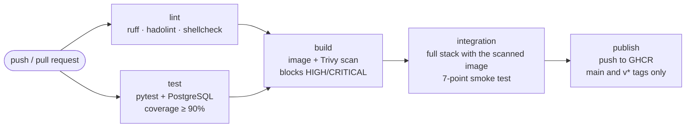

# CI/CD visit counter

[](https://github.com/MrHamdiChedli/cicd-visit-counter/actions/workflows/ci.yml)

The visit counter from [docker-visit-counter](https://github.com/MrHamdiChedli/docker-visit-counter), now delivered by a **CI/CD pipeline**.
Every push is linted, tested against a real PostgreSQL, built, scanned for vulnerabilities and tested end to end.
Only then is the image published to the GitHub Container Registry, and it is **exactly the image that passed the checks**, not a rebuild.

```bash
docker pull ghcr.io/mrhamdichedli/visit-counter:latest
```

## The pipeline



| Job | What it does | Fails the pipeline when |
|-----|--------------|-------------------------|
| **lint** | ruff on the Python code, hadolint on the Dockerfile, shellcheck on the scripts | Any lint error |
| **test** | Unit tests, plus integration tests against a PostgreSQL service container | A test fails or coverage drops under 90% (currently 100%) |
| **build** | Builds the image, scans it with Trivy, publishes the report in the repo's Security tab | A HIGH or CRITICAL vulnerability with an available fix is found |
| **integration** | Starts the whole Compose stack (Nginx, 2 replicas, PostgreSQL) with the scanned image and runs the smoke test from the Docker project | Load balancing, isolation, hardening, failover or persistence is broken |
| **publish** | Tags and pushes the tested image to `ghcr.io/mrhamdichedli/visit-counter` | Runs only on `main` and on `v*` tags, never on pull requests |

**Image tags:** `sha-<commit>` for every published commit, `latest` for `main`, and `1.2.3` for a `v1.2.3` git tag.

## Supply-chain security

- **Every GitHub Action is pinned to a full commit SHA**, not a tag like `@v4`. In March 2026, attackers rewrote almost every version tag of `aquasecurity/trivy-action` to point to code that stole CI secrets. Pipelines that used tags ran the malicious code; pipelines pinned by SHA did not.
- **Trivy runs from its Docker image pinned by digest** (`aquasec/trivy:0.76.1@sha256:…`), a version released after the incident was cleaned up.
- **Least privilege for the pipeline token**: read-only by default. Only the `build` job may write security reports, and only the `publish` job may push packages.
- **Dependabot** checks the Python dependencies, the base image and the actions every week and opens a pull request for each update. The pipeline then tests the update before anything is merged.

## Tests

```
tests/unit/                 No database needed: secret file vs environment, /healthz when the database is down
tests/integration/          Real PostgreSQL: /healthz is ok, the counter increments
tests/smoke-test.sh         The running stack: balancing, isolation, non-root, read-only, failover, persistence
```

Run them locally:

```bash
pip install -r app/requirements.txt -r requirements-dev.txt
pytest                                    # integration tests are skipped without DB_HOST
bash scripts/init-secrets.sh
docker compose up --detach --build --wait
bash tests/smoke-test.sh
```

## Repository layout

```
.github/workflows/ci.yml    The 5-job pipeline
.github/dependabot.yml      Weekly update PRs for pip, Docker and Actions
app/                        Flask app, multi-stage Dockerfile, SQL schema
compose.yaml                The stack; APP_IMAGE lets CI run the exact scanned image
tests/                      Unit, integration and smoke tests
```

## Next

Deploy this image to Kubernetes, with the pipeline updating the cluster.
